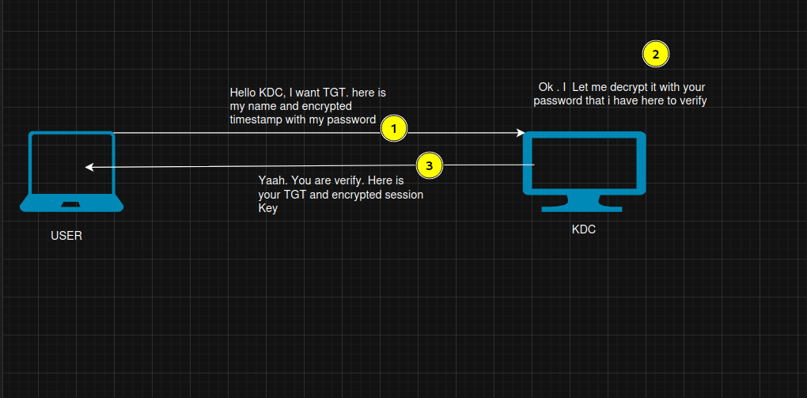
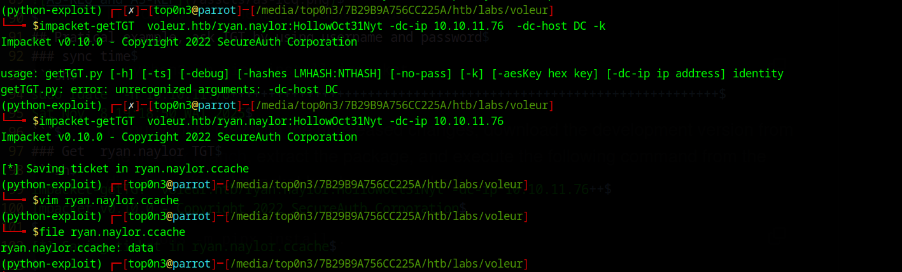

### KERBEROS AUTHENTICATION & TICKET GENERATION FLOW <br> 

The Kerberos protocol is widely used to implement authentication, especially in Active Directory (AD) environments.
To succeed as an internal penetration tester, it is crucial to understand how the Kerberos protocol works under the hood and how attackers can abuse it to compromise an internal AD environment.<br>
The purpose of this first article (**Part 0x00**) is to explain how the Kerberos protocol works step by step, so that in [Part 0x01](/posts/kerberos-attacks-part0x1/) we can focus on attacking Kerberos authentication in Active Directory.
Note that this article is written as a clear, accessible introduction for beginners—feel free to reach out if you spot any mistakes!

---

[I. Introduction to the Kerberos Protocol](#introduction)<br>
[II. Principal Components to Know](#components)<br>
[III. Kerberos AS-REQ / AS-REP (Getting a TGT)](#as)<br>
[IV. Kerberos TGS-REQ / TGS-REP (Getting a Service Ticket)](#tgs)<br>
[V. Kerberos AP-REQ / AP-REP (Accessing the Service)](#ap)<br>
[Conclusion](#conclusion)<br>

---

# I. Introduction to the Kerberos Protocol {#introduction}

In an Active Directory environment, **NTLM** and **Kerberos** are the two main protocols used to implement authentication.
Nowadays, Kerberos is the primary and preferred protocol because it is significantly more secure than NTLM.

Kerberos allows users to authenticate on the network and access services once authenticated. It uses **port 88** (TCP/UDP) by default and has been the default authentication protocol for domain accounts since Windows 2000. When a domain user logs into their workstation or accesses a network resource (such as an SMB share, MSSQL database, or internal web server), Kerberos handles the authentication.

Thanks to Kerberos, a user doesn't need to re-type their password every time they access a resource, and individual application servers don't need to know every user's password. This is an example of **centralized, ticket-based authentication**.

Crucially, **Kerberos is a stateless authentication protocol** based on encrypted tickets. It decouples a user's credentials from their requests to network resources, ensuring that plaintext passwords (or raw NTLM hashes) are never transmitted across the network.

---

# II. Principal Components to Know {#components}

To understand the Kerberos authentication workflow, let's first enumerate the essential components that interact during this process:

- **`Key Distribution Center` (`KDC`)**:
  The KDC is the core authority in the Kerberos protocol and runs directly on the **Domain Controller (DC)**. All ticket generation (both TGT and TGS) happens on the KDC, which has access to the Active Directory database (`NTDS.dit`) containing the secret keys (NTLM hashes and AES keys) of all domain users, computers, and service accounts. Logically, the KDC is divided into two sub-services:
  1. **Authentication Service (`AS`)**: Verifies the user's identity during initial login and issues **TGTs**.
  2. **Ticket Granting Service (`TGS`)**: Verifies a user's TGT and issues **Service Tickets** (commonly called **TGS tickets**) to access specific services.

- **`krbtgt` Account**:
  A special built-in account on the Domain Controller whose secret key (NTLM hash / AES key) is used by the KDC to encrypt and sign all **Ticket Granting Tickets (TGTs)**.

- **`User Account`**:
  An account representing a human user in Active Directory. Its password is used to derive symmetric cryptographic keys (RC4/NTLM hash, AES-128, and AES-256 keys).

- **`Service Account` & `Service Principal Name` (`SPN`)**:
  When you authenticate in an Active Directory environment, the ultimate goal is to access one or more network services (such as SMB/CIFS, MSSQL, HTTP, LDAP, etc.). Each service runs under the context of an AD account—either a **Computer Account** (e.g., `DC01$`) or a dedicated **Service User Account** (e.g., `svc_sql`), similar to how Apache runs under `www-data` on Linux.
  To allow Kerberos to map a service to the account running it, a **Service Principal Name (`SPN`)** (for example, `MSSQLSvc/sql01.voleur.htb:1433` or `cifs/dc01.voleur.htb`) is registered on that account.

- **`Ticket`**:
  In Kerberos, a ticket is an encrypted structure containing identity and authorization data most notably the **PAC (`Privilege Attribute Certificate`)**, which holds the user's SID, group memberships, and privileges—along with a copy of a **Session Key**.

- **`Ticket Granting Ticket` (`TGT`)**:
  The TGT is a user's "proof of identity" ticket issued by the KDC's Authentication Service (`AS`). The TGT itself is encrypted with the **`krbtgt` secret key**, meaning **only the KDC can read or decrypt a TGT**. The client stores the TGT in memory and presents it to the KDC whenever it wants to request a Service Ticket (TGS).

- **`Service Ticket` (commonly referred to as `TGS`)**:
  The final ticket issued by the KDC's Ticket Granting Service (`TGS`) that allows a user to authenticate to a specific target service. It is encrypted with the **target Service Account's secret key**, so only that specific service can decrypt it.

Now let's walk through how Active Directory authentication and service access work across the three Kerberos exchanges.

---

# III. Kerberos AS-REQ / AS-REP (Getting a TGT) {#as}

Authenticating to Active Directory starts with asking the KDC for a **TGT**. You can think of a TGT like a temporary corporate badge: once you prove your identity at the front desk (`AS`), you receive a badge (`TGT`) so you don't have to show your password every time you open a door.

Here is how this first exchange works:

1. **The Client Sends an `AS-REQ` (Authentication Service Request):**
   - The client sends an `AS-REQ` packet to the KDC (port 88) requesting a TGT for a specific username (`cname`).
   - To prove it actually knows the user's password without sending the password over the wire, the client includes an **Authenticator (`PA-ENC-TIMESTAMP`)**: the client's current timestamp encrypted using the cryptographic key derived from the user's password (either their **NTLM hash** for RC4-HMAC, or their **AES-128 / AES-256 key** in modern environments).
   - This step is called **Kerberos Pre-Authentication**.

   > **Why Time Synchronization Matters in Kerberos:**
   > Because the authenticator is an encrypted timestamp used to prevent replay attacks, your machine's clock must be within **5 minutes** of the Domain Controller's clock (the default Kerberos clock skew tolerance). If your clock is off by more than 5 minutes, the KDC will reject your request with **`KRB_AP_ERR_SKEW` (`Clock skew too great`)**!

2. **The KDC Validates the Request and Replies with an `AS-REP` (Authentication Service Reply):**
   - The KDC looks up the username in `NTDS.dit`, retrieves the user's secret key (NTLM hash / AES key), and attempts to decrypt the `PA-ENC-TIMESTAMP` authenticator.
   - If decryption succeeds and the timestamp is within 5 minutes, the user's identity is verified!
   - The KDC generates a random **Logon Session Key** (used to secure future communications between the client and the KDC) and returns an **`AS-REP`** containing **two separately encrypted parts**:
     1. **The `TGT` (`ticket`)**: Contains the user's **PAC** (SID, group memberships, privileges) and a copy of the **Logon Session Key**. This entire TGT is encrypted with the **`krbtgt` secret key** so the client cannot tamper with it.
     2. **The Outer Encrypted Data (`enc-part`)**: Contains the **Logon Session Key** and ticket metadata (such as expiration time), encrypted with the **User's secret key** so that the client can decrypt it and retrieve the Logon Session Key.

> **Security Note — What if Pre-Authentication is Disabled (`AS-REP Roasting`)?**
> An administrator can disable Kerberos Pre-Authentication for specific user accounts (`UF_DONT_REQUIRE_PREAUTH`). When disabled, the KDC will reply with an `AS-REP` to **anyone** who sends an `AS-REQ` for that username—without requiring a valid `PA-ENC-TIMESTAMP`!
> Note that an attacker still cannot *use* the returned TGT directly without knowing the user's password (because the **Logon Session Key** needed for the next step is locked inside `AS-REP.enc-part`, which is encrypted with the user's key). However, because `AS-REP.enc-part` is encrypted with the user's password hash, the attacker can crack it offline! We exploit this in detail in [Part 0x01 (AS-REP Roasting)](/posts/kerberos-attacks-part0x1/#asreproasting).



## Practical Example: Requesting a TGT with Username and Password
Let's use the `Voleur` HackTheBox machine to see this in practice.

### 1. Synchronize Time with the Domain Controller
```sh
sudo rdate -n 10.10.11.76
Sat Nov  8 19:18:50 WAT 2025
```

### 2. Request a TGT for `ryan.naylor`
```sh
impacket-getTGT voleur.htb/ryan.naylor:HollowOct31Nyt -dc-ip 10.10.11.76
Impacket v0.10.0 - Copyright 2022 SecureAuth Corporation

[*] Saving ticket in ryan.naylor.ccache
```
After running this command, Impacket performs the `AS-REQ` / `AS-REP` exchange, decrypts the `Logon Session Key` using `ryan.naylor`'s password, and saves both the **TGT** and the **Logon Session Key** inside `ryan.naylor.ccache`. We can now use this `.ccache` file to request Service Tickets (TGS) without typing the password again!



---

# IV. Kerberos TGS-REQ / TGS-REP (Getting a Service Ticket) {#tgs}

Once the user has a **TGT** (and the **Logon Session Key**), what happens when they want to access a specific network service, such as an SMB share (`cifs/dc01.voleur.htb`) or a SQL server (`MSSQLSvc/sql01.voleur.htb:1433`)?
They must ask the KDC's Ticket Granting Service (`TGS`) for a **Service Ticket**.

1. **The Client Sends a `TGS-REQ` (Ticket Granting Service Request) to the KDC:**
   The `TGS-REQ` contains three main elements:
   - **The Target `SPN` (`sname`)**: The Service Principal Name of the service the client wants to access (`ServiceClass/Host:Port`).
   - **The `TGT`**: The Ticket Granting Ticket received earlier in the `AS-REP`.
   - **A New `Authenticator`**: A current timestamp encrypted with the **Logon Session Key** (from the `AS-REP`).

2. **How the KDC Verifies `TGS-REQ` Without Storing Session State:**
   Remember earlier when we said **Kerberos is completely stateless**? The KDC does **not** store active session keys in memory!
   Instead, when the KDC receives the `TGS-REQ`:
   - It decrypts the **TGT** using its own **`krbtgt` secret key**.
   - Inside the decrypted TGT, the KDC finds the user's **PAC** and the **Logon Session Key** it originally generated during `AS-REP`!
   - The KDC uses that extracted **Logon Session Key** to decrypt the client's `Authenticator`. If decryption succeeds, the KDC knows the sender is the legitimate owner of the TGT!

3. **The KDC Replies with a `TGS-REP` (Ticket Granting Service Reply):**
   - Importantly, **the KDC does not check if the user has permission to access the target service**—as long as the TGT is valid and the SPN exists, the KDC generates a new **Service Session Key** and builds the Service Ticket!
   - The KDC returns a **`TGS-REP`** containing **two separately encrypted parts**:
     1. **The `Service Ticket` (`ticket`, often called the `TGS`)**: Contains the user's information (**PAC**) and a copy of the new **Service Session Key**. This entire Service Ticket is encrypted with the **Target Service Account's secret key** (NTLM hash or AES key).
     2. **The Outer Encrypted Data (`enc-part`)**: Contains the new **Service Session Key**, encrypted with the client's **Logon Session Key** (from the TGT), so the client can decrypt it and read the new Service Session Key.

> **Security Note — Why This Enables `Kerberoasting`:**
> Because any authenticated user can request a `TGS-REP` for any SPN in the domain, and the returned Service Ticket (`ticket.enc-part`) is encrypted with the **Service Account's secret key**, an attacker can extract that Service Ticket and brute-force the service account's password offline! We cover this in depth in [Part 0x01 (Kerberoasting)](/posts/kerberos-attacks-part0x1/#kerberoasting).

---

# V. Kerberos AP-REQ / AP-REP (Accessing the Service) {#ap}

Now that the client holds both the **Service Ticket (TGS)** and the **Service Session Key** (decrypted from `TGS-REP.enc-part`), the client no longer talks to the Domain Controller. Instead, it communicates **directly with the target application server**!

1. **The Client Sends an `AP-REQ` (Application Request) to the Target Service:**
   - The client sends the **Service Ticket (TGS)** along with a new **Authenticator** (a timestamp encrypted using the **Service Session Key** received from the `TGS-REP`).

2. **The Target Service Validates the Ticket and Authorizes the User:**
   - Because the Service Ticket was encrypted with the **Service Account's own secret key**, the service can decrypt the Service Ticket locally without even contacting the KDC!
   - From the decrypted Service Ticket, the service extracts the **Service Session Key** and the user's **PAC** (SID and group memberships).
   - It uses the extracted **Service Session Key** to decrypt the client's `Authenticator`.
   - If valid, the service inspects the user's **PAC** against its own local Access Control Lists (ACLs) to decide whether the user is authorized to access the resource.

3. **Optional `AP-REP` (Application Reply):**
   - If the client requested **mutual authentication**, the service replies with an **`AP-REP`** containing the timestamp encrypted with the **Service Session Key**, proving to the client that the server truly owns the service secret key.

---

# Conclusion {#conclusion}

As we have seen, the entire Kerberos authentication protocol is built on symmetric encryption across three clear steps (`AS`, `TGS`, and `AP`). Because tickets and session key structures are encrypted using keys derived from account passwords, weak passwords or Active Directory misconfigurations allow attackers to harvest tickets and compromise accounts.

Now that you understand every step of the Kerberos ticket generation flow, head over to **[Kerberos Attacks Part 0x01](/posts/kerberos-attacks-part0x1/)**, where we exploit this workflow in depth using **AS-REP Roasting**, **Kerberoasting**, **Targeted Roasting via ACL Abuse**, and **Unauthenticated Kerberoasting**!

Hope you learned something from this article! Thank you for reading, and feel free to reach out if you spot any mistakes or want further explanation.

<br>
HAPPY HACKING GEY
